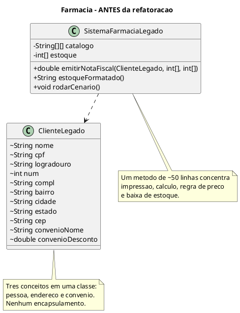
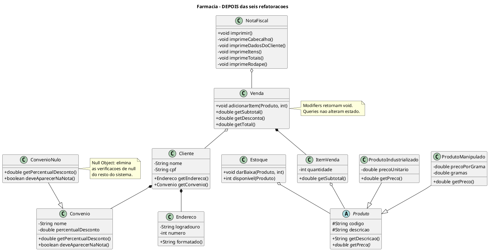

# Desenvolvimento de Sistemas II — Aula 2

## Guia de Referência: Refatoração

Material de consulta da Aula 2, complementar ao **Texto de Apoio** da disciplina.

O texto de apoio apresenta o **catálogo** de técnicas. Este guia acrescenta a **prática**: um único sistema Java que atravessa as seis categorias de refatoração, passo a passo, e um mecanismo que **prova** que o comportamento externo não mudou.


---

## 1) Ideia central da aula

Refatorar é **melhorar a estrutura interna do código sem alterar seu comportamento externo**.

Em termos simples:

- o sistema continua entregando o mesmo resultado para o usuário;
- o código fica mais legível, coeso e fácil de manter;
- futuras mudanças tendem a ficar mais seguras.

A segunda metade da definição — *"sem alterar o comportamento externo"* — não é uma promessa vaga: é uma afirmação **verificável**. É por isso que o projeto desta aula executa as duas versões do sistema e compara a saída caractere a caractere. Se as saídas divergirem, não houve refatoração: houve reescrita.

---

## 2) Conceitos essenciais

### Padrão (*pattern*)

Um padrão descreve uma solução recorrente para um problema recorrente em um contexto.

### Níveis de padronização vistos na disciplina

- **Enterprise:** alinhamento de sistemas com processos e estratégia da organização.
- **Architecture:** organização macro da solução (camadas, serviços, componentes).
- **Design:** colaboração entre classes e objetos.
- **Programming:** escrita de código e microdecisões de implementação.

> Nesta aula, o foco está no nível **Programming**, com impacto direto em **Design**.

### *Bad smell* ("mau cheiro")

É um **sinal de problema de design** no código. O termo foi criado por Kent Beck e popularizado por Martin Fowler.

Importante:

- *bad smell* **não é bug** — o código roda e entrega o resultado correto;
- *bad smell* indica que o código pode estar difícil de evoluir, entender ou testar — e que a probabilidade de bugs **futuros** é maior.

> **Não se preocupe em decorar** os nomes dos *bad smells* nem das técnicas. Com prática, você aprende a identificá-los. Os nomes originais em inglês são mantidos aqui, como no texto de apoio, para evitar mal-entendidos de tradução.

---

## 3) Quando faz sentido refatorar

Você provavelmente deve refatorar quando encontrar:

- métodos muito longos;
- classes com responsabilidades demais;
- condicionais repetitivas e complexas;
- estruturas de dados confusas;
- código duplicado;
- nomes pouco expressivos.

E quando **não** refatorar:

- quando não há como verificar que o comportamento continuou o mesmo (sem testes e sem uma saída observável, você está adivinhando);
- quando o código será descartado em breve;
- no meio de uma correção urgente de bug — corrija primeiro, refatore depois, em *commits* separados.

---

## 4) Técnicas de refatoração (mapa rápido)

As técnicas foram organizadas nas seis categorias do texto de apoio (inspiração: catálogo de Fowler e organização do *Refactoring Guru*). Para cada categoria, o exemplo que aplicaremos ao vivo:

| # | Categoria | Foco | Técnica na prática | *Bad smell* atacado |
|---|-----------|------|--------------------|---------------------|
| 1 | **Composing Methods** | escrita e organização de métodos | `Extract Method` | Long Method |
| 2 | **Moving Features Between Objects** | mover responsabilidades entre classes | `Extract Class` | Large Class / Data Clump |
| 3 | **Organizing Data** | representar dados com clareza | `Replace Array with Object` | Primitive Obsession |
| 4 | **Simplifying Conditional Expressions** | reduzir complexidade de `if`/`switch` | `Introduce Null Object` | verificações de `null` espalhadas |
| 5 | **Simplifying Method Calls** | métodos coesos, intenção explícita | `Separate Query from Modifier` | efeito colateral escondido |
| 6 | **Dealing with Generalization** | hierarquias e abstrações | `Extract Superclass` | Duplicated Code |

> A técnica **Replace Conditional with Polymorphism**, do grupo 4, será aprofundada na **Aula 4** (GRASP). Ela aparece de forma implícita no Passo 6 deste material.

---

## 5) O sistema da aula: Farmácia Refatorada

Todo o código gira em torno do mesmo mini-sistema — uma farmácia que emite nota fiscal, calcula descontos de convênio e dá baixa no estoque. Ele é uma extensão do exemplo `imprimeNF()` que abre o texto de apoio.

### Estrutura do projeto

```
aula2-refatoracao/
├── README.md                 <- este guia
└── src/
    ├── Main.java             <- roda as duas versões e compara as saídas
    ├── legado/
    │   ├── SistemaFarmaciaLegado.java   <- o "antes": funciona, mas cheira mal
    │   └── ClienteLegado.java
    └── refatorado/
        ├── Produto.java                 (abstrata)
        ├── ProdutoIndustrializado.java
        ├── ProdutoManipulado.java
        ├── Endereco.java
        ├── Cliente.java
        ├── Convenio.java
        ├── ConvenioNulo.java
        ├── ItemVenda.java
        ├── Venda.java
        ├── Estoque.java
        ├── NotaFiscal.java
        └── SistemaFarmaciaRefatorado.java
```

### O que o `Main` faz

Ele captura a saída de console das duas versões e compara. O resultado esperado é:

```
################## VEREDITO ###################

OK: comportamento externo PRESERVADO.
    As duas versoes produzem exatamente a mesma saida.
    Logo, o que fizemos foi REFATORACAO.
```

Essa técnica tem nome: **teste de caracterização** (*characterization test*, de Michael Feathers). É a rede de segurança clássica para mexer em código legado sem testes — primeiro você **congela** o comportamento atual, só **depois** refatora.

> Repare que a data da compra é uma constante fixa (`01/09/2026`) em vez de `new Date()`. Isso é proposital: código que depende do relógio produz saída diferente a cada execução e, por isso, é difícil de testar. Primeira lição de projeto, antes mesmo da primeira refatoração.

---

## 6) O ponto de partida: por que este código incomoda?

Todo o sistema legado cabe em duas classes. Abaixo, os trechos que concentram os problemas.

```java
// legado/SistemaFarmaciaLegado.java

// [SMELL 3] Primitive Obsession: o catálogo é uma matriz de texto.
// Colunas: 0=código | 1=descrição | 2=tipo | 3=preço (unitário OU por grama!) | 4=gramas
private String[][] catalogo = {
    {"1001", "Dipirona 500mg",        "INDUSTRIALIZADO", "12.90", "0"},
    {"1002", "Xarope de Guaco 120ml", "INDUSTRIALIZADO", "28.50", "0"},
    {"2001", "Pomada de Arnica",      "MANIPULADO",      "0.85",  "60"}
};

private int[] estoque = {10, 5, 3};   // array paralelo, ligado ao catálogo só pelo índice
```

```java
// [SMELL 1] Long Method + [SMELL 5] query misturado com modifier
public double emitirNotaFiscal(ClienteLegado cliente, int[] indices, int[] quantidades) {
    // 1. imprime cabeçalho
    // 2. imprime cliente + endereço
    // 3. percorre itens, calcula preço com if por tipo    <- [SMELL 6] duplicação
    //    e DÁ BAIXA NO ESTOQUE                            <- efeito colateral
    // 4. aplica desconto, com if (convenioNome != null)   <- [SMELL 4] null check
    // 5. imprime rodapé
    return total;                                          // <- e ainda devolve um valor
}
```

```java
// legado/ClienteLegado.java
// [SMELL 2] Large Class: pessoa + endereço + convênio na mesma classe
class ClienteLegado {
    String nome, cpf;
    String logradouro, compl, bairro, cidade, estado, cep;   // Data Clump
    int num;
    String convenioNome;      // pode ser null!
    double convenioDesconto;  // só faz sentido se convenioNome != null
}
```

### Diagrama do "antes"



**Nenhuma linha desse código está errada.** Ele produz a nota fiscal correta. O problema é inteiramente de *design* — e é exatamente essa distinção que a aula quer fixar.

---

## 7) Os seis passos, em detalhe

### Passo 1 — `Extract Method`

*Categoria: Composing Methods · Bad smell: Long Method*

**Problema:** existe um fragmento de código que pode ser agrupado. Se o método é longo demais, provavelmente há blocos coesos escondidos dentro dele.

**Solução:** mova o bloco para um método novo, com nome que explique o **quê**, e substitua o trecho original por uma chamada.

**Antes:**

```java
public double emitirNotaFiscal(...) {
    System.out.println("=======================================");
    System.out.println("         FARMACIA REFATORADA");
    System.out.println("              Nota Fiscal");
    System.out.println("         CNPJ: 998.998.998-98");
    System.out.println("=======================================");
    // ... + 45 linhas de itens, cálculo, desconto e rodapé
}
```

**Depois:**

```java
// refatorado/NotaFiscal.java
public void imprimir() {
    imprimeCabecalho();
    imprimeDadosDoCliente();
    imprimeItens();
    imprimeTotais();
    imprimeRodape();
}
```

**A regra prática mais útil desta aula:** se você sente vontade de escrever um comentário do tipo `// agora imprime o cabeçalho`, esse comentário é o **nome de um método esperando para nascer**.

**Ganho:** o método público virou um resumo legível da operação. `imprimeCabecalho()` e `imprimeRodape()` passam a poder ser reaproveitados por um recibo ou uma segunda via, sem copiar uma linha sequer.

---

### Passo 2 — `Extract Class`

*Categoria: Moving Features Between Objects · Bad smell: Large Class / Data Clump*

**Problema:** quando uma classe faz o trabalho de duas, sua coesão despenca.

**Solução:** crie uma classe nova e mova para ela os campos e métodos daquela responsabilidade.

**O sinal que dispara a técnica:** *Data Clump* — sete campos de endereço que andam **sempre** juntos. Um grupo de dados que anda junto é quase sempre uma classe esperando para nascer.

**Depois:**

```java
public class Endereco {
    private final String logradouro;
    private final int numero;
    private final String complemento;
    private final String bairro, cidade, estado, cep;

    /** O endereço sabe se formatar. A nota fiscal não precisa saber como. */
    public String formatado() {
        return logradouro + ", " + numero + " - " + complemento + "\n"
             + "Bairro: " + bairro + "\n"
             + cidade + "/" + estado + " - " + cep;
    }
}
```

**Ganho:** coesão (o `Cliente` volta a falar só de cliente) e reuso (`Fornecedor`, `Filial` e `Entregador` usam a mesma `Endereco`). E um princípio de bônus: *Tell, Don't Ask* — em vez de a nota fiscal **perguntar** os sete campos e montar o texto, ela **manda** o endereço se formatar.

---

### Passo 3 — `Replace Array with Object`

*Categoria: Organizing Data · Bad smell: Primitive Obsession*

**Problema:** o código tem uma matriz que contém vários tipos de dados.

**Solução:** substitua a matriz por objetos com atributos separados e tipados.

Os sintomas concretos no nosso catálogo:

- qual coluna é o preço? Só se descobre por tentativa (`catalogo[i][3]`... será?);
- o preço é número, mas está guardado como texto: exige `Double.parseDouble()` em todo uso;
- a coluna `gramas` só faz sentido para produto manipulado — nos outros, vira `"0"`;
- trocar a ordem das colunas quebra o sistema **silenciosamente**;
- o array `estoque` é paralelo ao catálogo, ligado apenas pelo índice.

**Depois:**

```java
public class ProdutoIndustrializado {
    private final String codigo, descricao;
    private final double precoUnitario;      // double de verdade, não String

    public double getPreco() { return precoUnitario; }
}

public class ProdutoManipulado {
    private final String codigo, descricao;
    private final double precoPorGrama, gramas;   // existe só onde faz sentido

    public double getPreco() {
        return precoPorGrama * gramas + TAXA_MANIPULACAO;
    }
}
```

> **Refatoração é incremental — e às vezes cria um novo *smell* de propósito.** Ao criar duas classes, acabamos de duplicar `codigo`, `descricao` e `getDescricao()`. Isso é aceitável: o Passo 6 resolve. Aceitar um estado intermediário imperfeito é parte do método.

---

### Passo 4 — `Introduce Null Object`

*Categoria: Simplifying Conditional Expressions · Bad smell: verificações de `null` espalhadas*

**Problema:** métodos retornam `null` (ou valores similares) em vez de objetos reais, o que obriga a verificações frequentes ao longo do código.

**Solução:** em vez de `null`, retorne um *Null Object* que encapsule o comportamento padrão.

**Antes** — a mesma pergunta feita duas vezes no mesmo método:

```java
if (cliente.convenioNome != null) {
    percentual = cliente.convenioDesconto;
} else {
    percentual = 0.0;
}
// ...
if (cliente.convenioNome != null) {
    System.out.println("Convenio " + cliente.convenioNome + ...);
}
```

**Depois:**

```java
public class ConvenioNulo extends Convenio {
    public ConvenioNulo() {
        super("", 0.0);              // comportamento neutro do "sem convênio"
    }

    @Override
    public double getPercentualDesconto() {
        return 0.0;                   // multiplicar por zero é inofensivo: sem "if"
    }

    @Override
    public boolean deveAparecerNaNota() {
        return false;                 // a nota simplesmente não imprime a linha
    }
}
```

E o cálculo do desconto, na classe `Venda`, fica assim — **sem uma única verificação de nulidade**:

```java
public double getDesconto() {
    return getSubtotal() * cliente.getConvenio().getPercentualDesconto();
}
```

**O pulo do gato conceitual:** a pergunta *"o objeto é nulo?"* virou a pergunta *"qual é o seu comportamento?"* — e a resposta passou a ser **polimórfica**. Compare com o exemplo do `AcompanhanteNulo` no texto de apoio: mesma técnica, outro domínio.

**Trade-off (toda técnica tem um):** *Null Object* é excelente quando "ausente" tem um comportamento neutro bem definido. Se a ausência do dado for um **erro** que precisa ser tratado, escondê-la atrás de um objeto neutro **mascara** o problema. Nesses casos, `Optional` ou uma exceção são escolhas melhores.

---

### Passo 5 — `Separate Query from Modifier`

*Categoria: Simplifying Method Calls · Bad smell: efeito colateral escondido*

**Problema:** o código possui um método que retorna um valor, mas também altera algum atributo do objeto.

**Solução:** divida em dois métodos — um que **retorna** o valor e outro que **modifica** o objeto.

A regra é mecânica:

| Tipo | Faz o quê | Retorna | Exemplo no projeto |
|------|-----------|---------|--------------------|
| **Modifier** (comando) | altera estado | `void` | `venda.adicionarItem(...)`, `estoque.darBaixa(...)` |
| **Query** (consulta) | não altera nada | um valor | `venda.getTotal()`, `estoque.disponivel(...)` |

**Antes** — impossível saber o total sem imprimir a nota e sem mexer no estoque:

```java
public double emitirNotaFiscal(...) {
    // ...
    estoque[i] = estoque[i] - qtd;   // modifier escondido no meio da impressão
    // ...
    return total;                     // query
}
```

**Depois:**

```java
// MODIFIER: altera estado, retorna void — de propósito.
public void adicionarItem(Produto produto, int quantidade) {
    itens.add(new ItemVenda(produto, quantidade));
}

// QUERIES: só leem. Podem ser chamadas 1 ou 100 vezes, com o mesmo resultado.
public double getSubtotal() { /* ... */ }
public double getDesconto() { /* ... */ }
public double getTotal()    { return getSubtotal() - getDesconto(); }
```

**Ganho:** previsibilidade. Consultas podem ser chamadas em qualquer ordem, quantas vezes for preciso, sem medo — e é justamente isso que torna o código **testável**. Essa separação tem nome na literatura: **Command-Query Separation**, de Bertrand Meyer.

---

### Passo 6 — `Extract Superclass`

*Categoria: Dealing with Generalization · Bad smell: Duplicated Code*

**Problema:** o código tem duas ou mais classes com atributos e métodos comuns.

**Solução:** crie uma superclasse e mova para ela tudo o que é idêntico.

**O critério de decisão — vale memorizar:**

| Situação | Para onde vai |
|----------|---------------|
| atributo/método **idêntico** nas duas | sobe **implementado** (`getDescricao()`) |
| existe nas duas, mas com **regra diferente** | sobe como **`abstract`** (`getPreco()`) |
| existe em **só uma** delas | **fica** na subclasse (`gramas`) |

**Depois:**

```java
public abstract class Produto {
    protected final String codigo;
    protected final String descricao;

    /** Idêntico nas duas subclasses -> implementado aqui, uma vez só. */
    public String getDescricao() { return descricao; }

    /** Existe nas duas, com regra própria em cada uma -> abstrato. */
    public abstract double getPreco();
}
```

**Ganho:** o resto do sistema (`Venda`, `NotaFiscal`, `Estoque`) passa a conversar apenas com `Produto`. Repare no `ItemVenda`:

```java
public double getSubtotal() {
    return produto.getPreco() * quantidade;   // nenhum "if" por tipo de produto
}
```

Adicionar amanhã um `ProdutoControlado` (com receita retida) não exige tocar em nenhuma dessas classes. O **Princípio Aberto/Fechado** aparece aqui não como uma regra decorada, mas como **consequência** da refatoração.

### Diagrama do "depois"



> Para visualizar: cole o bloco em <https://www.plantuml.com/plantuml> ou use a extensão *PlantUML* no VS Code / IntelliJ.

---

## 8) O placar final

Comparando `legado/SistemaFarmaciaLegado.java` com o pacote `refatorado`:

| | Legado | Refatorado |
|---|---|---|
| Classes | 1 grande + 1 de dados | 11 pequenas e coesas |
| Maior método | ~50 linhas | 10 linhas |
| Catálogo | `String[][]` + `int[]` paralelo | objetos `Produto` e `Estoque` |
| Verificações de `null` | 2 | 0 |
| `if` por tipo de produto | 2 | 0 (polimorfismo) |
| *Query* e *modifier* | no mesmo método | separados |
| **Saída no console** | — | **exatamente a mesma** |

A última linha é a definição de refatoração.

E note o que **não** melhorou: o número de arquivos triplicou. Esse é o custo real. Em um sistema minúsculo como este, dá para argumentar que o legado é mais simples de ler de uma vez só. A refatoração compensa quando o código precisa **crescer** — e quase todo código de produção precisa.

---

## 9) Fontes para consulta contínua

- Catálogo oficial de refatorações: <https://refactoring.com/catalog/>
- *Refactoring Guru* (visão didática, em português): <https://refactoring.guru/pt-br/refactoring>
- Categoria *Composing Methods*: <https://refactoring.guru/refactoring/techniques/composing-methods>
- Categoria *Moving Features between Objects*: <https://refactoring.guru/refactoring/techniques/moving-features-between-objects>
- FOWLER, M. *Refactoring: Improving the Design of Existing Code*. 2. ed. Addison-Wesley, 2018.
- FEATHERS, M. *Working Effectively with Legacy Code*. Prentice Hall, 2004. (origem do teste de caracterização)
